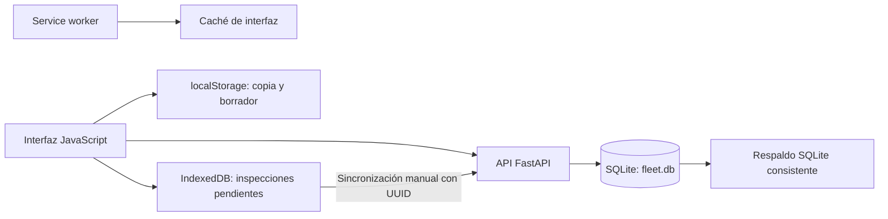
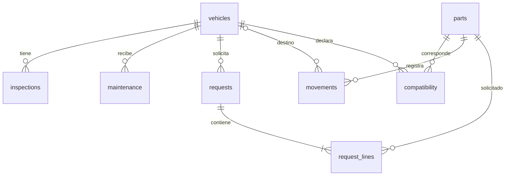

# Informe técnico de Gold Engine Fleet

Fecha: 12 de octubre de 2026. Proyecto analizado: `PROYECTO-VEHICULOS`.

## 1. Diagnóstico y alcance

La aplicación es un prototipo funcional local para mantenimiento, inspecciones y bodega vehicular. Tiene una base apropiada para continuar con FastAPI, SQLite y JavaScript: cantidades exactas en milésimas, claves foráneas, transacciones para stock, inspecciones con identificador de cliente y respaldo consistente. Sin embargo, todavía presenta fallos que pueden perder datos de checklist, alterar alertas de mantenimiento y duplicar operaciones de inventario cuando se reintentan.

El estado declarado en `README.md:5` coincide con la arquitectura observada: piloto local, pendiente de controles para operación compartida. El resultado de las pruebas actuales es positivo, pero su cobertura no alcanza los defectos detectados en esta revisión.

Se inspeccionaron todos los archivos fuente, configuración y pruebas del proyecto; el esquema declarado y la base SQLite existente; el entorno Python instalado; y los recursos de la PWA. La base real se consultó en modo de solo lectura. Las reproducciones de operaciones utilizaron bases temporales fuera del proyecto. No se modificaron código, configuración, dependencias del proyecto ni datos reales. El único archivo nuevo del proyecto es este informe.

Se distingue entre:

- **Confirmado por ejecución:** resultado observado con TestClient, funciones del backend, SQLite o una VM de Node.
- **Confirmado por inspección:** comportamiento deducible del código; no significa que ya haya ocurrido pérdida o explotación.
- **Riesgo condicionado:** requiere crecimiento, cambios de plantilla, acceso compartido u otras condiciones indicadas.

No se hizo una prueba integral con navegador real, instalación en teléfonos, cierre forzado, corte de energía o carga sostenida. Los resultados de VM no sustituyen una prueba del DOM completo, IndexedDB y service worker en el navegador.

## 2. Estructura y responsabilidades

```text
PROYECTO-VEHICULOS/
├── server.py                      Backend, validaciones, esquema SQL y API
├── seed_vehicles.py               Carga inicial opcional de nueve vehículos
├── checklist_liviano.json         Plantilla: cinco grupos y 37 verificaciones
├── requirements.txt              Dependencias de ejecución
├── INICIAR_WINDOWS.bat            Entorno virtual, instalación y arranque local
├── CARGAR_VEHICULOS_WINDOWS.bat    Ejecución de la carga opcional
├── README.md                      Instalación, alcance y límites del piloto
├── .gitignore                     Excluye bases, entornos y archivos generados
├── data/
│   ├── .gitkeep
│   └── fleet.db                   Base real local; excluida de Git
├── static/
│   ├── index.html                 Contenedor de la aplicación
│   ├── app.js                     Formularios, vistas, API, borradores y cola
│   ├── app.css                    Presentación adaptable e impresión
│   ├── manifest.webmanifest       Metadatos de instalación PWA
│   ├── service-worker.js          Caché de recursos de interfaz
│   └── icons/                     PNG de 192 y 512 píxeles
├── tests/test_fleet.py            Siete pruebas automatizadas de API
├── vista_previa_pc.png            Recurso de vista previa; no es prueba de UI actual
└── vista_previa_movil.png         Recurso de vista previa; no es prueba de UI actual
```

También existen `.git/`, `.venv/` y `__pycache__/`. No se encontraron instrucciones `AGENTS.md` en el repositorio ni en los directorios ascendentes revisados. El estado de Git estaba limpio al comenzar.

`server.py` tiene 552 líneas. `static/app.js` tiene 114 líneas, muchas de gran longitud, y `app.css` concentra sus reglas en cuatro líneas. Esta concentración facilita distribuir el piloto, pero complica revisar y mantener los flujos de mayor riesgo. No hace falta adoptar un framework para corregirla.

## 3. Arquitectura actual

El navegador ejecuta una aplicación con siete vistas: inicio, vehículos, inspecciones, mantenimientos, repuestos, solicitudes e historial. Su navegación cambia el contenido de `#screen`; no existe un router ni un proceso de compilación frontend.

Uvicorn sirve la aplicación ASGI de FastAPI. El backend entrega HTML, archivos estáticos, manifest y service worker; Pydantic valida los cuerpos de las solicitudes; las funciones acceden directamente a SQLite con consultas parametrizadas. No hay ORM, capa de servicios independiente, sistema de usuarios ni migraciones.



El servidor es la autoridad para stock, solicitudes, mantenimientos e inspecciones confirmadas. El navegador conserva una copia de consulta y registros todavía no sincronizados. No existe actualización en tiempo real entre clientes: la interfaz recarga `/api/bootstrap` al iniciar, después de operaciones propias y al recuperar conectividad.

La ubicación de la base se obtiene de `GEFLEET_DB` o de `data/fleet.db` (`server.py:26-29`). Cada conexión habilita claves foráneas, establece una espera de bloqueo de 15 segundos y solicita WAL (`server.py:36-51`). La conexión utiliza autocommit; las operaciones que deben agrupar cambios abren explícitamente `BEGIN IMMEDIATE`.

El script Windows inicia Uvicorn en `127.0.0.1:8000` (`INICIAR_WINDOWS.bat:14`). Esta configuración sirve al equipo local. No constituye un despliegue para teléfonos u otros equipos.

### Superficie de la API

| Área | Rutas implementadas |
|---|---|
| Interfaz/PWA | `GET /`, `/service-worker.js`, `/manifest.webmanifest`, recursos `/static/*` |
| Estado | `GET /api/bootstrap`, `/api/health` |
| Vehículos | `POST /api/vehicles`, `PATCH /api/vehicles/{id}` |
| Inspecciones | `POST /api/inspections`, `GET /api/inspections/{id}` |
| Bodega | `POST /api/parts`, `POST /api/movements` |
| Mantenimiento | `POST /api/maintenance` |
| Solicitudes | `POST /api/requests`, `GET /api/requests/{id}`, `POST /api/requests/{id}/approve`, `POST /api/requests/{id}/deliver` |
| Exportación | `GET /api/export/{what}` para vehículos, inspecciones, movimientos y mantenimientos |
| Respaldo | `GET /api/backup` |

Además se publica documentación de la API en `/api/docs`. Las 15 rutas API descritas no verifican identidad ni permisos.

## 4. SQLite: esquema, relaciones y estado efectivo

La base existente tiene 57.344 bytes. Su estructura coincide con el SQL de `init_db()` (`server.py:54-108`). La revisión se realizó con una conexión URI de solo lectura, `immutable=1` y `query_only=ON`; no había archivos WAL/SHM auxiliares al inspeccionar. El encabezado de la base corresponde al formato WAL, coherente con el backend.

| Tabla | Función y relaciones | Filas actuales |
|---|---|---:|
| `vehicles` | Catálogo y odómetro actual; placa única | 9 |
| `inspections` | FK a vehículo; UUID único; respuestas y fotos como JSON | 0 |
| `maintenance` | FK a vehículo; servicio, lectura e intervalo | 0 |
| `parts` | Catálogo; código único; unidad y mínimo | 0 |
| `compatibility` | Relación vehículo/repuesto; PK compuesta | 0 |
| `movements` | FK a repuesto y FK opcional a vehículo; entradas/salidas | 0 |
| `requests` | FK a vehículo; solicitante, estado y autorización nominal | 0 |
| `request_lines` | FK a solicitud y repuesto; cantidad pedida y entregada | 0 |

Los nueve vehículos se distribuyen en tres livianos, tres pesados, uno especial y dos por verificar. No existe historial operativo en esta base.



La cardinalidad mínima de una línea por solicitud en el diagrama expresa la regla de la API; SQLite por sí solo no impide una solicitud sin líneas.

Resultados de comprobación:

- `PRAGMA integrity_check`: `ok`.
- `PRAGMA foreign_key_check`: sin violaciones.
- Ocho tablas, nueve claves foráneas, cuatro índices automáticos y el índice explícito `idx_mov_part`.
- Todas las claves foráneas tienen acciones `NO ACTION`.
- `PRAGMA user_version`: `0`; no existe versionado efectivo del esquema.
- Comprobaciones agregadas de stock negativo, JSON inválido y discrepancias de cantidades: cero anomalías. Con siete tablas vacías, este resultado no demuestra que los flujos reales estén libres de defectos.

El esquema protege placas/códigos/UUID únicos, cantidades positivas, mínimos y odómetros no negativos, y `0 <= delivered_milli <= qty_milli`. No impone estados enumerados de solicitud, tipo de vehículo, unicidad de repuesto por solicitud o coherencia entre intervalo y próximo kilometraje. Varias de esas reglas existen únicamente en la API.

## 5. Funciones implementadas y pendientes

| Área | Implementado | Pendiente o limitación observada |
|---|---|---|
| Vehículos | Alta, edición, ficha, marca/modelo/tipo y kilometraje | Correcciones auditadas del odómetro, concurrencia y gestión efectiva de `active` |
| Checklist | Liviano: 37 preguntas, BIEN/MAL/NA, notas, hasta tres fotos, consulta e impresión | Pesados; versionado de plantilla; persistencia fiable del borrador; notas estructuradas |
| Mantenimiento | Registro de trabajo realizado; intervalo opcional; objetivo por kilómetros | Catálogo estable de servicios, selección cronológica correcta y consulta completa de planes |
| Repuestos | Alta, búsqueda, mínimos, unidad, número de parte y compatibilidad inicial | Edición de catálogo/compatibilidades; política de advertencia de incompatibilidad |
| Stock | Entradas, salidas y salidas por entregas; control de insuficiencia | Idempotencia, reversos/correcciones auditados y vínculos estructurados a entregas |
| Solicitudes | API con varias líneas; autorización nominal; entrega parcial/total | UI crea solo una línea; rechazo/cancelación; identidad de aprobador y reserva de stock |
| Documentos | Impresión mediante navegador, cuatro CSV y respaldo SQLite | Restauración guiada/verificada; exportación de pendientes locales; formato oficial de solicitud |
| Offline | Interfaz almacenada, copia de datos, borrador y cola de inspecciones | Recuperación individual de errores, protección ante cuota y pruebas de navegador |
| Operación compartida | API HTTP y controles transaccionales de stock | Usuarios, roles, auditoría de acciones, HTTPS remoto y actualización entre clientes |

No se observaron integración con BodegaPro, Google Drive, firmas electrónicas, APK, costos contables, lotes/series ni órdenes de trabajo completas. Varias de estas ausencias están declaradas en `README.md:48-57`; no son requisitos que deban incorporarse ahora sin una necesidad concreta.

## 6. Reglas actuales de kilometraje, mantenimiento y repuestos

### Kilometraje y mantenimiento

Las inspecciones y servicios guardan su propia lectura y actualizan el vehículo con `MAX(odometer, lectura)` (`server.py:284`, `391`). Esto admite registrar una lectura histórica menor sin reducir automáticamente el kilometraje actual. La edición directa del vehículo no utiliza esa protección.

El próximo objetivo se calcula como `lectura_del_servicio + intervalo_km`. Si no hay intervalo, no se genera objetivo. La interfaz calcula kilómetros restantes contra el odómetro del vehículo y marca vencido cuando son cero o negativos; utiliza 500 km como umbral fijo de advertencia (`static/app.js:44-51`). No se generan intervalos universales ni vencimientos por fecha.

El servicio se identifica por texto libre y vehículo. Mayúsculas, abreviaturas o cambios de nombre pueden producir planes independientes. El registro elegido como último se determina por orden de inserción, no por fecha de ejecución. Además, solo se consideran los últimos 200 mantenimientos globales recibidos por bootstrap.

No existe una política explícita para diferenciar cero kilómetros de lectura desconocida, validar saltos inusuales, registrar sustitución de odómetro o asociar autor/motivo a una corrección. Tampoco existe validación de coherencia cronológica entre fecha y lectura. Conviene definir estas reglas antes de bloquear legítimos registros históricos.

### Repuestos y solicitudes

El stock es la suma de entradas menos salidas del libro `movements`; no se mantiene un saldo duplicado. `milli()` admite cantidades positivas de hasta tres decimales y las convierte a enteros, con límite por operación (`server.py:136-151`). Cuando la unidad es exactamente `unidad`, se exigen cantidades enteras. La API permite unidades como texto libre, por lo que conviene normalizar su catálogo.

Las solicitudes no descuentan ni reservan stock. Su flujo es `PENDIENTE → APROBADA → PARCIAL/ENTREGADA`; la entrega vuelve a comprobar disponibilidad. Por tanto, una solicitud aprobada puede quedarse sin existencias si otra operación consume el repuesto antes.

Las salidas y entregas se ejecutan con transacción de escritura. La entrega genera movimientos, actualiza cantidades entregadas y cambia el estado de la solicitud en una sola confirmación. Esto protege frente a stock insuficiente y entregas multirenglón incompletas.

Las compatibilidades son declaraciones informativas. No filtran las opciones ni advierten/bloquean movimientos y solicitudes para otro vehículo. Un mantenimiento no descuenta repuestos y no está relacionado estructuralmente con una entrega; el formulario comunica esa separación.

## 7. Hallazgos priorizados

**P1:** corregir antes de un piloto con registros que deban conservarse; el hallazgo de acceso aplica antes de compartir la aplicación. **P2:** resolver durante la estabilización y antes del crecimiento o cambio indicado. **P3:** mejoras de operación y mantenimiento posteriores.

### P1: conservación, cálculo e inventario

| ID | Hallazgo, evidencia y comprobación | Impacto y acción recomendada |
|---|---|---|
| H01 | El checklist no repuebla vehículo y fecha al mostrar Datos, ni observaciones al mostrar Finalizar (`static/app.js:94`, `96-98`). VM Node confirmó vehículo `1 → 0`, fecha válida `→ vacío` y observación `→ vacío` al volver a guardar los campos renderizados. | Puede inutilizar un borrador o perder observaciones. Repoblar todos los campos y comprobar navegación de ida/vuelta y reapertura. |
| H02 | El botón × cierra sin guardar el paso actual (`static/app.js:108`); el guardado ocurre al cambiar de paso o cerrar por el fondo. No hay guardado continuo por `input`. Confirmado por inspección. | Se pierde lo escrito desde el último guardado al cerrar con ×, recargar o abandonar la pestaña. Unificar cierres y añadir persistencia durante la edición. |
| H03 | `PATCH /api/vehicles` reemplaza campos y permite reducir odómetro (`server.py:202-234`). TestClient confirmó que enviar solo placa y nombre deja odómetro en 0 y marca vacía. La edición completa también permite bajar la lectura. | Alertas pueden dejar de marcar vencimientos; una edición antigua puede sobrescribir una lectura reciente. Aplicar PATCH parcial y control de versión; separar lectura normal de corrección justificada. |
| H04 | Movimientos y entregas no tienen clave de idempotencia (`server.py:350-370`, `459-489`). Repetir una entrada crea dos movimientos; dos envíos idénticos de una entrega parcial de una unidad devolvieron 200 y acumularon dos unidades entregadas. | Una respuesta perdida y su reintento pueden duplicar entradas o salidas, aun sin stock negativo. Identificar cada operación y devolver su resultado anterior ante un reintento. |
| H05 | `latestDue()` toma el primero por vehículo/nombre (`static/app.js:44-46`), sobre `ORDER BY id DESC LIMIT 200` (`server.py:193`). VM confirmó que un servicio de 2025 cargado después desplaza al de 2026. | Puede crear alertas falsas, ocultar un plan vigente o dejar de avisar de un vencimiento. Consultar planes completos y seleccionar el último servicio por una regla cronológica explícita. |
| H06 | Las notas se concatenan y cortan a 2500 caracteres en frontend y backend (`static/app.js:100`, `server.py:282`), sin rechazo ni aviso. Confirmado por inspección. | Pueden desaparecer las últimas observaciones de fallas después de guardar con éxito. Conservar notas por ítem o validar el límite antes de aceptar el registro. |
| H07 | Aprobación, escritura, exportaciones y descarga de la base carecen de autenticación/autorización (`server.py:32`, `435`, `530`). El backup responde sin identidad. | Si se comparte el acceso, cualquiera con conectividad puede actuar y obtener la base completa. Implementar cuentas y roles antes de operar en red. La configuración actual de loopback limita ese alcance. |

### P2: integridad, sincronización y recuperación

| ID | Hallazgo y evidencia | Impacto y acción recomendada |
|---|---|---|
| H08 | Plantilla sin versión; claves de respuesta por posición `grupo-ítem`; detalle histórico devuelve la plantilla actual (`server.py:29-30`, `68`, `298`; `static/app.js:86`, `101`). | Reordenar o cambiar preguntas puede reinterpretar inspecciones antiguas y bloquear pendientes. Guardar identificadores estables y versión/copia de plantilla antes de ampliarla. |
| H09 | Fecha de mantenimiento solo exige texto no vacío (`server.py:389`). `performed_on='fecha inexistente'` respondió 200. Odómetros sin máximo; `2**63` respondió 500. | Historial con fechas inválidas y errores internos por valores fuera de rango. Validar calendario y límites, devolviendo errores de validación claros. |
| H10 | Una respuesta HTTP 422 no cambia a conectado si el estado anterior era offline (`static/app.js:18-20`); `submitCheck` usa ese estado para encolar (`:100`). Confirmado en VM. | Un rechazo de validación puede anunciarse como guardado sin conexión. Distinguir fallo de transporte de rechazo de negocio. |
| H11 | `syncPending()` se detiene en el primer error; la UI solo muestra contador y botón (`static/app.js:60`, `107`). VM confirmó que el segundo registro válido no se intenta si el primero falla. | Un pendiente inválido bloquea el resto. Mostrar error por registro y permitir corregir/exportar pendientes mientras se envían los válidos. |
| H12 | `load()` trata la consulta y `localStorage.setItem` dentro del mismo `try` (`static/app.js:24-26`); `saveCheckDraft()` no maneja cuota (`:88`). | Un fallo de almacenamiento puede reemplazar datos recién leídos por una copia vieja o interrumpir el guardado. Separar errores, mostrar antigüedad de la copia y manejar cuotas. |
| H13 | Backup cubre SQLite, pero no borradores/cola del navegador (`server.py:530`; `static/app.js:87-88`, `102-107`). No hay exportación de pendientes ni persistencia solicitada. | Borrar datos del sitio, cambiar perfil/equipo/origen o sufrir eliminación del almacenamiento puede perder registros no enviados. Añadir recuperación/exportación y aviso de datos exclusivamente locales. |
| H14 | UUID existente devuelve `duplicate=True` sin comparar contenido (`server.py:273-276`). TestClient confirmó éxito con otro odómetro bajo el mismo UUID. | Dos variantes del mismo borrador pueden recibir éxito aunque una no se conserve. Mantener idempotencia y devolver conflicto ante contenido diferente. |
| H15 | Bootstrap limita a 200 inspecciones, movimientos y solicitudes, además de mantenimientos; devuelve todas las líneas (`server.py:191-196`). La UI no indica el límite. | Pendientes antiguos dejan de verse y KPIs no representan totales históricos. Separar consultas de pendientes/totales y paginar el historial. |
| H16 | Bootstrap ejecuta varios SELECT en autocommit sin transacción de lectura (`server.py:39`, `185-196`). No hay refresco entre clientes salvo recargas. | Una operación concurrente puede producir stock anterior combinado con cantidades/estado posteriores. Usar una lectura coherente e indicar/actualizar la vigencia de los datos. |
| H17 | `init_db()` solo hace `CREATE TABLE IF NOT EXISTS`; `user_version=0` (`server.py:54-108`). | Una futura ampliación puede dejar bases antiguas sin columnas/restricciones nuevas. Incorporar migraciones pequeñas con versión, respaldo y verificación. |
| H18 | README permite copiar `fleet.db` sin explicar el estado del servidor (`README.md:68`), mientras se usa WAL (`server.py:43`). | Copiar únicamente el archivo durante actividad puede omitir transacciones del WAL. Priorizar `/api/backup`; documentar copia con servidor detenido y comprobar restauración. |
| H19 | SQLite del entorno es 3.45.3. Documentación oficial identifica el fallo raro WAL-reset en versiones hasta 3.51.2; requiere conexiones concurrentes y tiempos específicos. No se observó corrupción. | Actualizar el runtime a una distribución con SQLite corregido antes de ampliar uso concurrente, verificando `sqlite3.sqlite_version`. Mantener SQLite; no sustituirlo por este hallazgo. |
| H20 | Entregas se relacionan con solicitudes mediante texto `SOL-xxxxx`, sin FK a solicitud/línea; se sobrescribe el último `received_by` (`server.py:82-87`, `482-486`). | Auditoría y conciliación incompletas de entregas parciales. Vincular estructuralmente movimientos/entregas y conservar receptor, autor y fecha por evento. |
| H21 | Faltan restricciones DB de estado, tipo y unicidad de repuesto por solicitud; compatibilidad no se aplica; unidades/servicios son textos libres (`server.py:59`, `99`, `103-106`, `327`, `417-423`, `478`). | Escrituras externas y variantes de texto pueden quebrar reglas o crear planes duplicados. Definir catálogos mínimos y reforzar reglas aprobadas en API/DB. |
| H22 | `GEFLEET_DB` puede apuntar a otra ubicación; `connect()` crea carpeta/base. La copia local no identifica una instancia de base (`server.py:28`, `38-39`; `static/app.js:25`, `87`). | Una ruta incorrecta aparenta pérdida de información; una cola antigua podría usar IDs de una base reemplazada. Mostrar/verificar ubicación y vincular cola/copia a la instancia de datos. |

El riesgo H19 está documentado en [SQLite: WAL-reset bug](https://sqlite.org/wal.html). La corrección está en SQLite 3.51.3 y posteriores, con backports 3.44.6 y 3.50.7. SQLite describe una probabilidad baja; el informe no atribuye corrupción actual a este fallo.

Los riesgos de cuotas y eliminación del almacenamiento de H12-H13 están respaldados por [MDN: Storage quotas and eviction criteria](https://developer.mozilla.org/en-US/docs/Web/API/Storage_API/Storage_quotas_and_eviction_criteria). La ausencia de protección específica se comprobó en el código; no se provocó eliminación de datos del navegador real.

### P3: operación y mantenimiento

- **Impresión:** la regla de impresión no oculta `#screen` cuando se imprime un modal (`static/app.css:4`, `static/app.js:73`). Puede incluir pantalla y documento; requiere comprobar salida real/PDF.
- **Accesibilidad:** selects y textareas sin asociación explícita de etiqueta, radios sin foco visible y modales sin control de foco/Escape (`static/app.js:72-77`, `95`, `108`; `static/app.css:1`). El HTML sí incluye atributos de diálogo y regiones de estado.
- **Actualizaciones PWA:** `skipWaiting/clients.claim` activa el worker inmediatamente; se eliminan todas las cachés del origen de nombre distinto, sin filtrar el prefijo de la aplicación; errores de registro se silencian (`static/service-worker.js:3-4`, `static/app.js:113`). Planificar actualización por versión y comunicar fallos de instalación.
- **Reproducibilidad y crecimiento:** dependencias con rangos amplios; instalación en cada arranque; faltan índices en varias FKs. Fotos base64 y backup materializado en memoria aumentarán tamaño y consumo (`requirements.txt:1-2`, `INICIAR_WINDOWS.bat:9`, `server.py:68`, `533-544`). Registrar versiones probadas y medir antes de añadir infraestructura o índices.
- **Fotografías:** se verifican límite, formato base64 y dos bytes iniciales JPEG, sin decodificar la imagen (`server.py:261-268`). Una cadena con solo cabecera JPEG respondió 200 en la comprobación. Reforzar validación si se necesita garantizar evidencia visual utilizable.

## 8. Seguridad: controles presentes y límites

Las consultas SQL utilizan parámetros; no se identificó una inyección SQL confirmada. El frontend escapa los textos mostrados mediante `esc()` (`static/app.js:6`); no se confirmó una explotación XSS en los flujos revisados. La API restringe las fotos a cadenas JPEG/base64, lo que reduce el riesgo al insertarlas en `src`. Esto no equivale a una auditoría de penetración completa.

Las exportaciones CSV anteponen una comilla a cadenas que pueden activar fórmulas de Excel (`server.py:500-510`). `.gitignore` excluye bases y sidecars; Git solo registra `data/.gitkeep` dentro de esa carpeta.

Los nombres `approved_by`, `delivered_by`, `received_by` e `inspector` son declaraciones de texto, no identidades verificadas. Las marcas de tiempo y referencias existentes ayudan a revisar operaciones, pero no forman una auditoría de autores, cambios y correcciones. El backup contiene toda la base, incluidas fotografías cuando existan.

Los datos en localStorage/IndexedDB pertenecen al perfil y origen del navegador, sin separación por usuario ni vinculación a una base concreta. No se observaron controles de acceso por cuenta ni mecanismos de recuperación externa de esos datos. La arquitectura local actual reduce exposición de red, pero no resuelve la autorización cuando se habilite acceso compartido.

## 9. Estado actual de la PWA

El manifest es JSON válido, con nombre, idioma `es-EC`, `start_url` y `scope` en `/`, modo `standalone`, colores e iconos PNG existentes de 192×192 y 512×512. Estos son elementos de una PWA instalable; no se verificó una instalación real en navegador o dispositivo.

El service worker precarga la interfaz y usa red primero con caché como alternativa. Excluye `/api/`, por lo que no intercepta las operaciones de negocio para responder con datos almacenados. La app guarda por separado una copia del bootstrap en localStorage.

| Función | Disponibilidad sin servidor |
|---|---|
| Abrir interfaz | Preparada si antes se descargó y activó correctamente el worker |
| Consultar catálogos/listados | Copia del último bootstrap; puede estar desactualizada |
| Completar checklist | Preparado tras primera carga; con defectos de borrador indicados |
| Enviar checklist | Se intenta API; ante fallo de transporte se guarda pendiente en IndexedDB |
| Abrir inspección completa | Requiere API; la copia no incluye respuestas/fotos completas |
| Abrir solicitud completa | Requiere API |
| Mantenimiento, stock, solicitudes, aprobaciones y entregas | Requieren API; no tienen cola offline |
| Recuperar conexión | Recarga copia y cuenta pendientes; envío mediante botón manual |
| Exportar o descargar backup | Requiere API; no cubre pendientes locales |

No hay Background Sync, sincronización automática en segundo plano ni resolución individual de conflictos. La cola está indexada por `client_uuid` y la API evita duplicar la misma inspección, con el límite de comparación de contenido descrito en H14.

`localhost` y `127.0.0.1`, distintos puertos o perfiles tienen almacenamientos separados. Cambiar la URL puede hacer que un borrador o pendiente deje de verse sin que se haya enviado. La aplicación no indica expresamente esta dependencia.

Para usar service workers fuera del entorno local se necesita contexto seguro, normalmente HTTPS; MDN documenta la excepción de desarrollo para localhost en [Using Service Workers](https://developer.mozilla.org/en-US/docs/Web/API/Service_Worker_API/Using_Service_Workers). El inicio actual en loopback no permite acceso directo desde el teléfono.

## 10. Pruebas ejecutadas y cobertura

### Entorno observado

| Componente | Versión |
|---|---|
| Python del entorno del proyecto | 3.13.0 |
| SQLite incorporado | 3.45.3 |
| FastAPI | 0.143.0 |
| Starlette | 1.7.0 |
| Pydantic | 2.14.1 |
| Uvicorn | 0.54.0 |
| Node.js | 22.1.0 |

`pytest` y `httpx` no estaban instalados en `.venv`. Se instalaron únicamente en un directorio temporal externo y se incorporaron al proceso de pruebas mediante `PYTHONPATH`, sin modificar `requirements.txt` ni `.venv`. Se usaron pytest 9.1.1 y httpx 0.28.1. Los fixtures sustituyen `server.DB` por una base temporal antes de iniciar la aplicación (`tests/test_fleet.py:7-12`).

Ejecución de la suite existente:

```text
.venv\Scripts\python.exe -B -m pytest -q -p no:cacheprovider --basetemp=<directorio temporal externo>
7 passed, 3 warnings in 1.12s
```

Se deshabilitaron caché de pytest y escritura de bytecode para preservar el proyecto. Las advertencias fueron el uso de `on_event` de FastAPI y del cliente httpx en la versión instalada de Starlette. No impidieron ejecutar la suite. FastAPI recomienda el ciclo de vida `lifespan` en su [documentación oficial](https://fastapi.tiangolo.com/advanced/events/); ese ajuste tiene menor prioridad que los defectos operativos.

### Cobertura efectiva de las siete pruebas

| Prueba | Comportamiento verificado |
|---|---|
| `test_home_and_manifest` | HTML, worker, manifest y catálogo vacío |
| `test_vehicles_seed_is_optional` | Carga opcional repetible de nueve unidades |
| `test_part_stock_milli_and_prevent_negative` | Entradas/salidas, insuficiencia, fracción de unidad e infinito |
| `test_lubricants_decimal` | Cantidades decimales exactas y salida insuficiente |
| `test_request_approval_delivery_and_reject_insufficient` | Solicitud no descuenta, requiere aprobación, entrega parcial/total y rechazo posterior |
| `test_inspection_idempotent_and_checklist_only_liviano` | Respuestas completas, repetición de UUID, lectura y detalle |
| `test_maintenance_dates_and_export_backup` | Objetivo por km, respuesta CSV y cabecera SQLite |

Los nombres no acreditan comprobaciones adicionales: la prueba de inspecciones no crea un vehículo pesado, la de mantenimiento no envía una fecha inválida y la de solicitudes no provoca insuficiencia durante una entrega aprobada. La prueba del backup comprueba cabecera; la integridad completa del snapshot se verificó por separado en esta auditoría.

### Verificaciones adicionales

- Sintaxis Python compilada en memoria: `server.py`, `seed_vehicles.py` y `tests/test_fleet.py`, correcta.
- `node --check` para `app.js` y `service-worker.js`: correcto.
- JSON del manifest y dimensiones de iconos: correctos.
- `pip check` del entorno existente: sin incompatibilidades declaradas.
- Dos salidas concurrentes sobre una unidad disponible: respuestas 200 y 409; stock final cero. Se verificó la protección transaccional.
- Entrega de dos líneas donde la segunda no tenía stock: 409; ambas cantidades entregadas siguieron en cero y el stock de la primera se conservó. Se verificó rollback integral.
- Snapshot descargado de una base temporal: `integrity_check=ok`, sin violaciones de FK.
- Reproducciones HTTP de PATCH parcial, fecha inválida, exceso del entero SQLite, entrega parcial repetida, UUID con contenido diferente y JPEG incompleto: resultados descritos en los hallazgos.
- Probes de VM Node: pérdida de campos del borrador, fecha histórica elegida como último mantenimiento, clasificación de HTTP 422 y bloqueo de la cola. La conversión de cantidades `es-EC` del formulario de entrega funcionó en los valores comprobados; no se identificó allí un defecto.

No hay pruebas existentes del DOM, IndexedDB, reconexión real, actualización del worker, impresión o instalación móvil. Tampoco cubren restauración, más de 200 registros, cambios de plantilla, control de permisos o reintentos idempotentes de inventario. Las pruebas nuevas deberían dirigirse a esos comportamientos concretos y a las correcciones acordadas, sin reproducir simplemente el código.

## 11. Desarrollo progresivo recomendado

### Etapa 1: conservar registros y evitar duplicación

Corregir H01-H06: restauración y guardado del borrador; conservación de observaciones; PATCH y política de corrección de kilometraje; clave de operación para movimientos/entregas; selección correcta y consulta completa de planes.

Criterios de aceptación: un checklist conserva todos los campos al cambiar de paso, cerrar y reabrir; ninguna nota desaparece sin aviso; editar nombre no modifica otras propiedades; una lectura posterior no se pierde por edición antigua; reintentar una operación no vuelve a afectar stock; cargar mantenimiento histórico no sustituye al vigente; superar 200 servicios no oculta planes.

### Etapa 2: estabilizar offline y evolución de datos

Separar transporte de validación, gestionar errores por pendiente, permitir recuperación/exportación, manejar cuotas y mostrar antigüedad de la copia. Añadir versión de plantilla, comparación de contenido bajo un mismo UUID y vinculación a la instancia de base. Introducir migraciones pequeñas con respaldo previo.

Criterios de aceptación: un 422 se muestra como validación; un pendiente inválido no bloquea los válidos; los registros locales pueden recuperarse; un cambio de plantilla no reinterpreta historia; una migración se verifica sobre copia de una base previa.

### Etapa 3: recuperación e integridad operacional

Validar fechas y límites, definir catálogos mínimos de servicios/unidades, paginar historial y consultar pendientes completos. Vincular entregas y movimientos de forma estructurada. Documentar y probar restauración de la copia consistente; verificar ubicación real de la base. Actualizar el runtime con SQLite corregido conservando la tecnología existente.

Criterios de aceptación: restauración comprobada con conteos, FK e integridad; datos inválidos responden con validación; historial completo consultable; conciliación de entregas por relaciones, sin depender de texto; versión SQLite corregida registrada.

### Etapa 4: acceso compartido, solo cuando se necesite

Implementar identidad y permisos por acción, autoría verificable y trazabilidad de correcciones. Preparar HTTPS y servidor accesible si se requiere uso móvil. Probar sesión, autorizaciones, actualización entre clientes y pérdida de conectividad. H07 es condición previa para esa apertura, aunque esta etapa se ejecute después de estabilizar el piloto local.

Criterios de aceptación: un usuario sin permiso no aprueba ni entrega; exportaciones/backup tienen acceso controlado; la auditoría identifica quién actuó; un dispositivo puede instalar y recuperar pendientes con pruebas reales de navegador.

### Etapa 5: completar flujos según formatos y necesidad operativa

Solicitudes con varias líneas desde la UI, rechazo/cancelación, edición controlada de catálogo/compatibilidad, formatos oficiales y checklist pesado cuando exista plantilla validada. Después, mejoras de impresión, accesibilidad y legibilidad del código. Horómetros, lotes, contabilidad o integraciones requieren confirmar su alcance antes de implementarse.

No se justifica cambiar FastAPI, SQLite o JavaScript para resolver los hallazgos actuales. La prioridad es consolidar reglas de negocio, recuperación y pruebas. Una futura decisión de infraestructura debería basarse en volumen y concurrencia medidos.

## 12. Conservación de archivos y límites de cierre

La comparación SHA-256 final de los 20 archivos originales, incluido `data/fleet.db`, confirmó cero modificaciones. Git muestra únicamente este informe como archivo nuevo. No se ejecutaron los scripts de arranque/carga contra la base real ni se publicó la aplicación.

Las comprobaciones adicionales produjeron archivos de prueba en la carpeta temporal de Windows. La política automática de ejecución bloqueó su limpieza; permanecen fuera del proyecto y no contienen una copia de la base real.

Los principales riesgos son de comportamiento y recuperación, no de corrupción observada en la base actual. La recomendación operativa es continuar como piloto local y resolver primero los hallazgos P1 antes de empezar a depender de los registros para la operación diaria.
